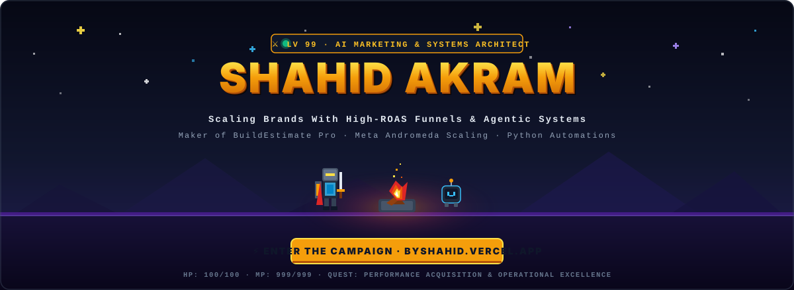

<div align="center">
  
</div>

<div align="center">

[](https://byshahid.vercel.app/)
[](https://linkedin.com/in/shahidakram)
[](mailto:heyshahidakram@gmail.com)
[](https://byshahidakram.substack.com/)
[](https://byshahid.medium.com/)

</div>

---

### 👨‍💻 Executive Summary

> **I design high-converting paid acquisition funnels and build custom web tools that automate operations.**  
> Rather than relying on clunky spreadsheets that break in the field, I engineer purpose-built software that accelerates project estimations, tracks media spend, and delivers verifiable business results.

- 🎯 **Paid Media Scaling:** Managing performance ad budgets, Andromeda scale testing, and funnel conversion rate optimization.
- 🏗️ **Operational Systems:** Engineering lightweight Progressive Web Apps (PWAs) and Python scripts to eliminate operational friction.
- 🌐 **Global Reach:** Serving clients and contractors across the US, UK, UAE, and APAC.

---

### 🛠️ Featured Production Systems & Open-Source Tools

<table>
  <tr>
    <td width="50%" valign="top">
      <h3>🏗️ <a href="https://heyshahid.github.io/buildestimate-app/">BuildEstimate Pro</a></h3>
      <p><em>Mobile-First Construction Material Takeoff & Contractor Bid Suite (PWA)</em></p>
      <p>An installable web application engineered for General Contractors, Project Managers, and Construction VAs to calculate on-site material volumes and generate official 1-page PDF proposals.</p>
      <ul>
        <li><strong>Concrete &amp; Slabs:</strong> Instant cubic yards, truck counts &amp; rebar grid specs.</li>
        <li><strong>Framing &amp; Drywall:</strong> Stud spacing, plate LF &amp; sheet takeoff deductions.</li>
        <li><strong>1-Page Bid Proposal:</strong> Clean executive PDF export with client signature blocks.</li>
      </ul>
      <p>
        <a href="https://heyshahid.github.io/buildestimate-app/"><strong>🚀 Launch Live App</strong></a> &nbsp;|&nbsp;
        <a href="https://github.com/heyshahid/buildestimate-app"><strong>📂 Repository</strong></a>
      </p>
    </td>
    <td width="50%" valign="top">
      <h3>📊 <a href="https://byshahid.vercel.app/">Shahid Akram – Agency Portfolio</a></h3>
      <p><em>Executive Portfolio &amp; Direct Acquisition Engine</em></p>
      <p>Clean, ultra-fast single-page web portfolio showcasing client case studies, paid ad frameworks, published essays, and service agreements.</p>
      <ul>
        <li><strong>Performance Stack:</strong> Pure modern responsive architecture.</li>
        <li><strong>Content Syndication:</strong> Integrated with Substack &amp; Medium newsletters.</li>
        <li><strong>Conversion Focus:</strong> Streamlined scheduling and inquiry funnels.</li>
      </ul>
      <p>
        <a href="https://byshahid.vercel.app/"><strong>🌐 Visit Portfolio</strong></a>
      </p>
    </td>
  </tr>
</table>

---

### ⚡ Core Competencies & Technical Arsenal

```yaml
Growth & Paid Acquisition:
  - Meta Ads Manager (Facebook & Instagram)
  - Andromeda Media Scaling & Break-Even Modeling
  - Funnel Conversion Rate Optimization (CRO)
  - Creative Direction & Performance Copywriting

Web & System Engineering:
  - Modern HTML5, Responsive UI, Tailwind CSS
  - Progressive Web Apps (PWA) & Offline Service Workers
  - Python Automation, Web Scraping & REST APIs
  - Git Version Control & GitHub Actions CI/CD

Operations & Project Management:
  - Construction Material Takeoffs & Contractor Bidding
  - Notion, ClickUp & Asana Workflow Automation
  - High-Ticket Remote Operations & Client Delivery
```

---

### 📈 GitHub Activity & Contributions

<div align="center">
  
  &nbsp;
  
</div>

---

<div align="center">
  <p><strong>Want to discuss an ad campaign, custom tool, or remote operations lead role?</strong></p>
  <a href="mailto:heyshahidakram@gmail.com">
    
  </a>
</div>
